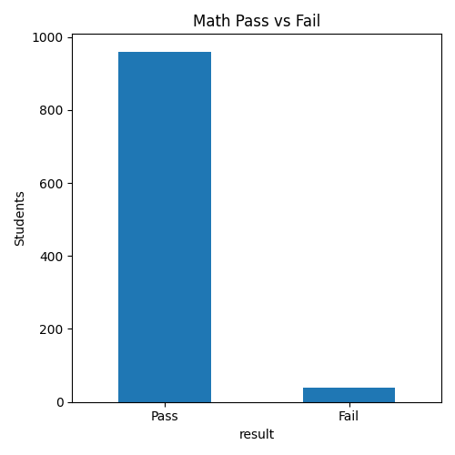
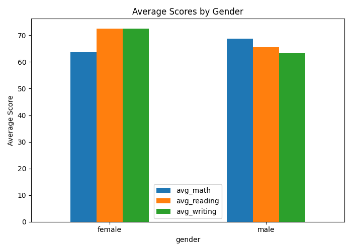
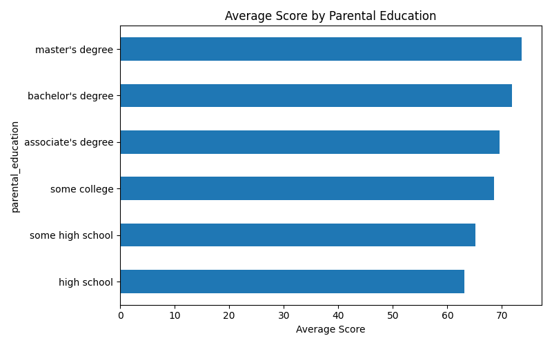
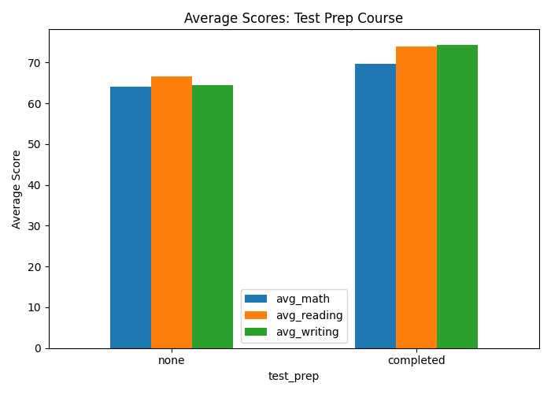

# Students Performance Analysis (MySQL + Python)

An end-to-end data analytics project integrating **MySQL** and **Python** to analyze student exam performance across gender, parental education, and test preparation courses.

## Tools & Libraries Used
- **Database:** MySQL (`students_db`)
- **Python Libraries:** Pandas, SQLAlchemy, PyMySQL, Matplotlib

## Project Files
- `StudentsPerformance_dataset.csv` — Dataset containing 1,000 student records.
- `students_queries.sql` — SQL scripts for database creation and exploratory analysis.
- `students_sql_python.py` — Python script connecting to MySQL via SQLAlchemy to fetch query results and generate visualizations.

## Key Insights & Visualizations

### 1. Math Pass vs Fail (Pass Mark: 40)

### 2. Average Scores by Gender

### 3. Average Score by Parental Education

### 4. Impact of Test Preparation Course

